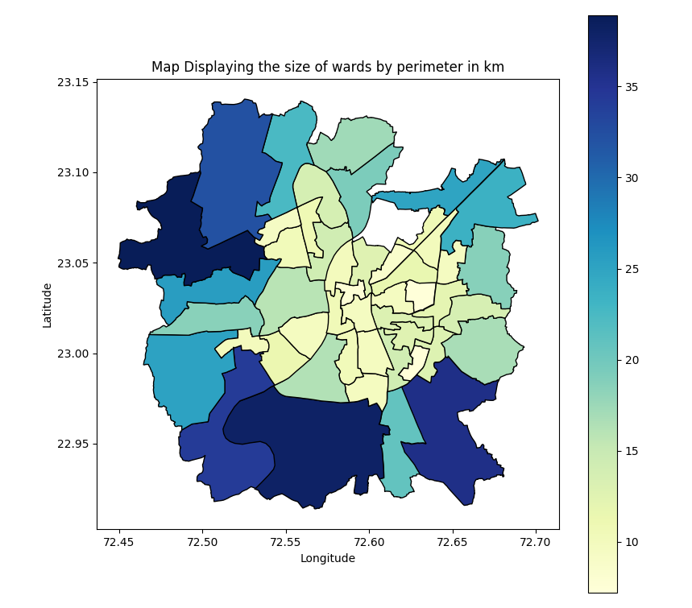
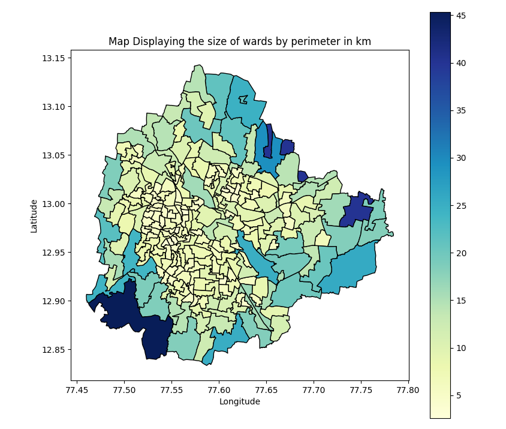
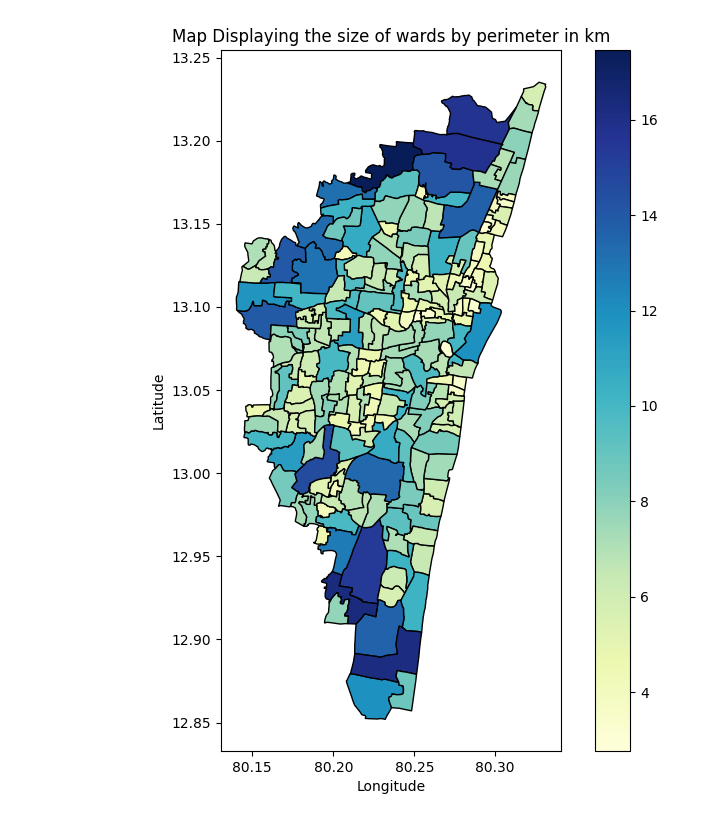
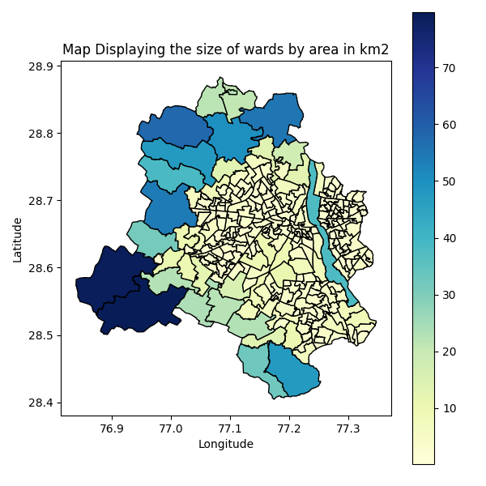
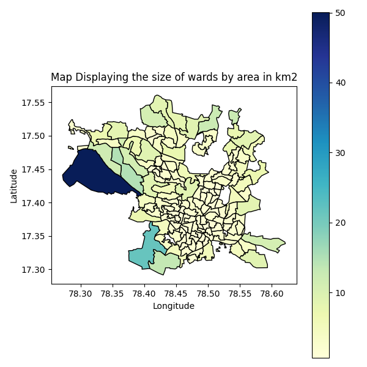
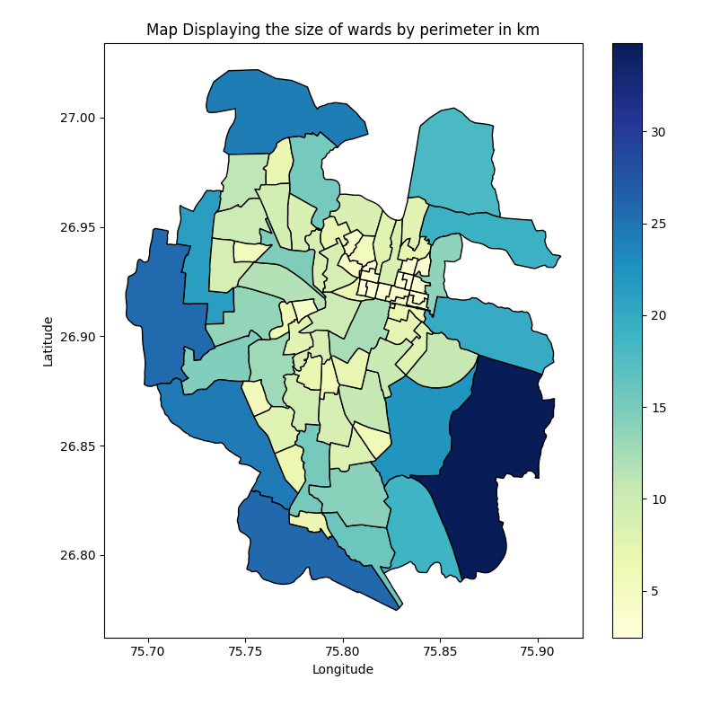
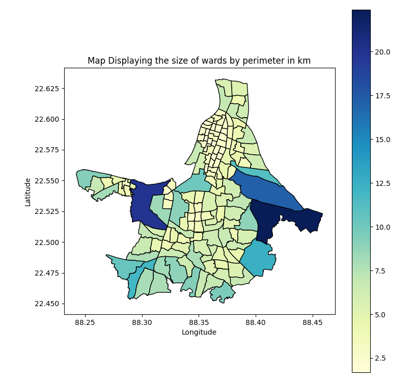
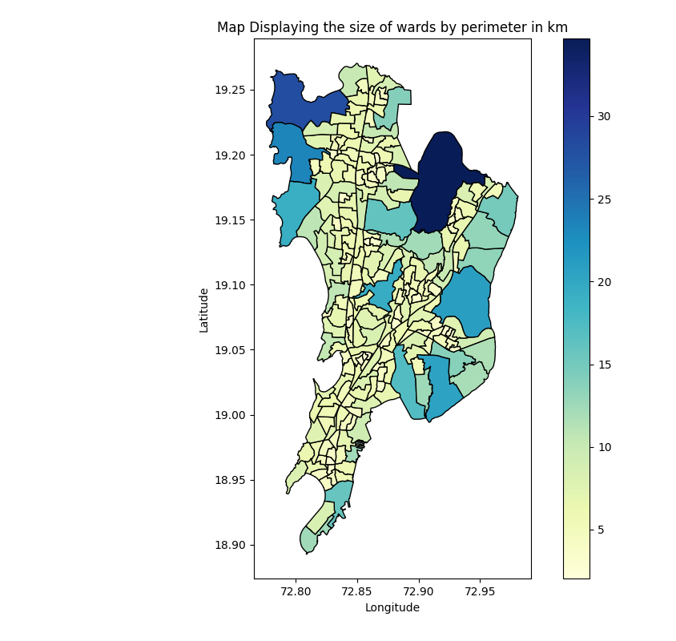

<div align="center">

# 📏 Ward Perimeter Map

**A branch of [Urban Mobility Geographic Information Systems](https://github.com/shreyanspeaking-arch/Urban-Mobility-Geographic-Information-Systems), a collection of Python programs that map and measure the wards of Indian cities.**

  

</div>

The perimeter of a ward is the length of its boundary. Set against its area, it shows how compact or how stretched and irregular each ward is.

## 📂 Programs in this branch

| Program | What it does |
|---|---|
| [**Ward Perimeter Map**](#ward-perimeter-map) | Perimeter of each ward in km, saved to Excel and shown on a map |

## ⚙️ Getting started

```bash
git clone -b Ward-Perimeter-Map --single-branch https://github.com/shreyanspeaking-arch/Urban-Mobility-Geographic-Information-Systems.git
cd Urban-Mobility-Geographic-Information-Systems
curl -LO https://github.com/shreyanspeaking-arch/Urban-Mobility-Geographic-Information-Systems/raw/Input-gpkg-files/delhi_wards.gpkg
pip install geopandas pandas matplotlib openpyxl
python ward_perimeter.py
```

Every program is interactive: it asks for its inputs one at a time in the terminal, then saves the results to an `.xlsx` file and shows a map. Input files for 8 cities are on the [Input gpkg files](https://github.com/shreyanspeaking-arch/Urban-Mobility-Geographic-Information-Systems/tree/Input-gpkg-files) branch.

---

## Ward Perimeter Map

📄 **File:** [`ward_perimeter.py`](./ward_perimeter.py)

Computes the perimeter of every ward in a city from a ward-boundary file, saves the list of wards and their perimeters to Excel, and draws a choropleth map of the wards shaded by perimeter.

**How it works**

1. The user enters the name of a ward-boundary file, such as a `.gpkg` file from the [Input gpkg files](https://github.com/shreyanspeaking-arch/Urban-Mobility-Geographic-Information-Systems/tree/Input-gpkg-files) branch. If the file has no `WARD` column, the program lists its columns and asks which one holds the ward name or number; it does the same for the geometry column.
2. The ward shapes are projected to UTM zone 45N (`EPSG:32645`) so that they can be measured in metres, and the length of each ward's boundary is computed and converted to km.
3. The user enters a name for the output file (without `.xlsx`). The program saves the columns `WARD` and `Perimeter (in km)` to that Excel file, then projects the wards back to latitude and longitude and draws a map of the wards shaded by perimeter.

**🧪 Sample input and output**

| Input | Output |
|---|---|
| [`ahmedabad_wards.gpkg`](https://github.com/shreyanspeaking-arch/Urban-Mobility-Geographic-Information-Systems/blob/Input-gpkg-files/ahmedabad_wards.gpkg) | [`ahmedabad.xlsx`](./ahmedabad.xlsx)<br>[`ahmedabad.png`](./ahmedabad.png) |
| [`bengaluru_wards_2022.gpkg`](https://github.com/shreyanspeaking-arch/Urban-Mobility-Geographic-Information-Systems/blob/Input-gpkg-files/bengaluru_wards_2022.gpkg) | [`bengaluru.xlsx`](./bengaluru.xlsx)<br>[`bengaluru.png`](./bengaluru.png) |
| [`chennai_wards.gpkg`](https://github.com/shreyanspeaking-arch/Urban-Mobility-Geographic-Information-Systems/blob/Input-gpkg-files/chennai_wards.gpkg) | [`chennai.xlsx`](./chennai.xlsx)<br>[`chennai.png`](./chennai.png) |
| [`delhi_wards.gpkg`](https://github.com/shreyanspeaking-arch/Urban-Mobility-Geographic-Information-Systems/blob/Input-gpkg-files/delhi_wards.gpkg) | [`delhi.xlsx`](./delhi.xlsx)<br>[`delhi.png`](./delhi.png) |
| [`hyderabad_wards.gpkg`](https://github.com/shreyanspeaking-arch/Urban-Mobility-Geographic-Information-Systems/blob/Input-gpkg-files/hyderabad_wards.gpkg) | [`hyderabad.xlsx`](./hyderabad.xlsx)<br>[`hyderabad.png`](./hyderabad.png) |
| [`jaipur_wards.gpkg`](https://github.com/shreyanspeaking-arch/Urban-Mobility-Geographic-Information-Systems/blob/Input-gpkg-files/jaipur_wards.gpkg) | [`jaipur.xlsx`](./jaipur.xlsx)<br>[`jaipur.png`](./jaipur.png) |
| [`kolkata_wards_141.gpkg`](https://github.com/shreyanspeaking-arch/Urban-Mobility-Geographic-Information-Systems/blob/Input-gpkg-files/kolkata_wards_141.gpkg) | [`kolkata.xlsx`](./kolkata.xlsx)<br>[`kolkata.png`](./kolkata.png) |
| [`mumbai_electoral_wards_2017.gpkg`](https://github.com/shreyanspeaking-arch/Urban-Mobility-Geographic-Information-Systems/blob/Input-gpkg-files/mumbai_electoral_wards_2017.gpkg) | [`mumbai.xlsx`](./mumbai.xlsx)<br>[`mumbai.png`](./mumbai.png) |

<!-- preview:start -->
**📋 First five rows**

<details>
<summary><code>ahmedabad.xlsx</code></summary>

| WARD | Perimeter (in km) |
|---|---|
| 48 RAMOL HATHIJAN | 35.69 |
| 47 VATVA | 20.886 |
| 46 LAMBHA | 37.993 |
| 45 ISANPUR | 9.703 |
| 44 KHOKHRA | 14.23 |

<sub>48 rows in total.</sub>

</details>

<details>
<summary><code>bengaluru.xlsx</code></summary>

| WARD | Perimeter (in km) |
|---|---|
| 1 | 21.201 |
| 2 | 14.594 |
| 3 | 11.415 |
| 4 | 13.204 |
| 5 | 9.671 |

<sub>243 rows in total.</sub>

</details>

<details>
<summary><code>chennai.xlsx</code></summary>

| WARD | Perimeter (in km) |
|---|---|
| 119 | 6.825 |
| 7 | 13.696 |
| 26 | 10.691 |
| 174 | 13.382 |
| 132 | 5.641 |

<sub>201 rows in total.</sub>

</details>

<details>
<summary><code>delhi.xlsx</code></summary>

| WARD | Perimeter (in km) |
|---|---|
| DELHI CANTT CHARGE 1 | 5.923 |
| DELHI CANTT CHARGE 2 | 16.078 |
| DELHI CANTT CHARGE 4 | 22.826 |
| DELHI CANTT CHARGE 5 | 8.39 |
| DELHI CANTT CHARGE 6 | 23.218 |

<sub>290 rows in total.</sub>

</details>

<details>
<summary><code>hyderabad.xlsx</code></summary>

| WARD | Perimeter (in km) |
|---|---|
| Ward 91 Khairatabad | 19.021 |
| Ward 105 Gachibowli | 36.727 |
| Ward 60 Rajendra Nagar | 30.004 |
| Ward 95 Jubilee Hills | 20.038 |
| Ward 6 Nacharam | 11.556 |

<sub>145 rows in total.</sub>

</details>

<details>
<summary><code>jaipur.xlsx</code></summary>

| WARD | Perimeter (in km) |
|---|---|
| 76 | 19.262 |
| 34 | 34.831 |
| 11 | 21.227 |
| 12 | 25.853 |
| 13 | 13.501 |

<sub>77 rows in total.</sub>

</details>

<details>
<summary><code>kolkata.xlsx</code></summary>

| WARD | Perimeter (in km) |
|---|---|
| 93 | 6.486 |
| 61 | 3.568 |
| 86 | 5.597 |
| 90 | 6.235 |
| 26 | 2.856 |

<sub>141 rows in total.</sub>

</details>

<details>
<summary><code>mumbai.xlsx</code></summary>

| WARD | Perimeter (in km) |
|---|---|
| A | 12.437 |
| A | 15.809 |
| B | 5.652 |
| A | 8.338 |
| E | 7.126 |

<sub>227 rows in total.</sub>

</details>
<!-- preview:end -->

**🗺️ Sample maps**

| | |
|:-:|:-:|
| **Ahmedabad**<br><br><sub>ahmedabad.png</sub> | **Bengaluru**<br><br><sub>bengaluru.png</sub> |
| **Chennai**<br><br><sub>chennai.png</sub> | **Delhi**<br><br><sub>delhi.png</sub> |
| **Hyderabad**<br><br><sub>hyderabad.png</sub> | **Jaipur**<br><br><sub>jaipur.png</sub> |
| **Kolkata**<br><br><sub>kolkata.png</sub> | **Mumbai**<br><br><sub>mumbai.png</sub> |

---

<div align="center"><sub>📚 <a href="https://github.com/shreyanspeaking-arch/Urban-Mobility-Geographic-Information-Systems">Back to all topics</a></sub></div>
