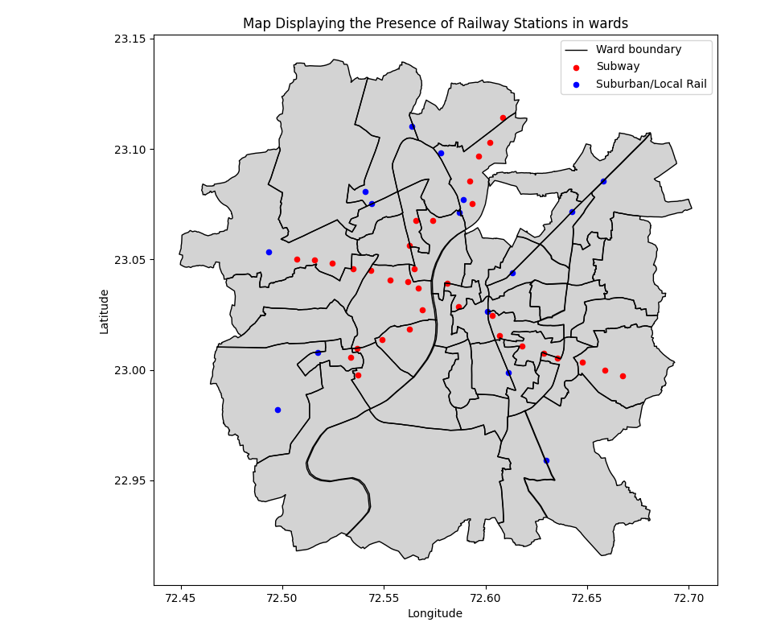
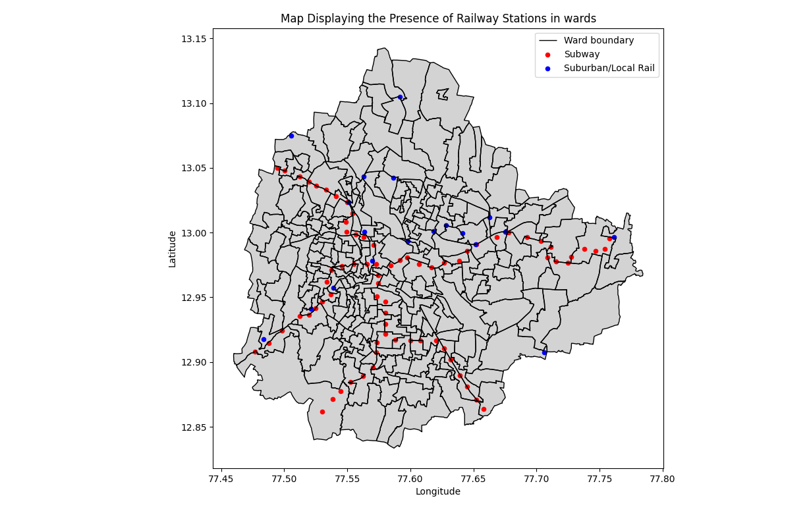
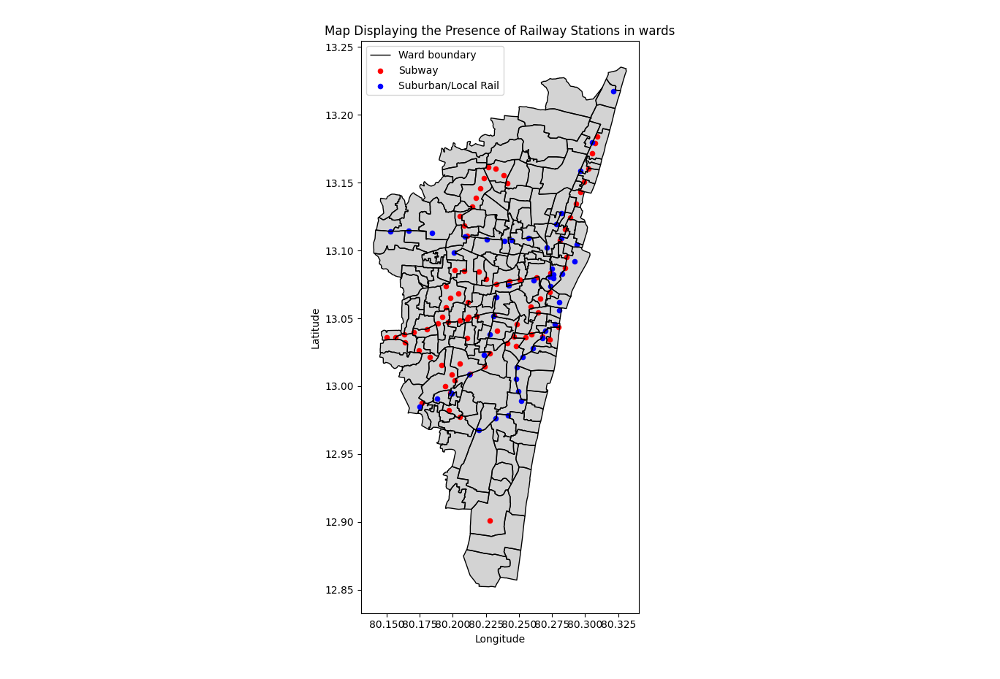
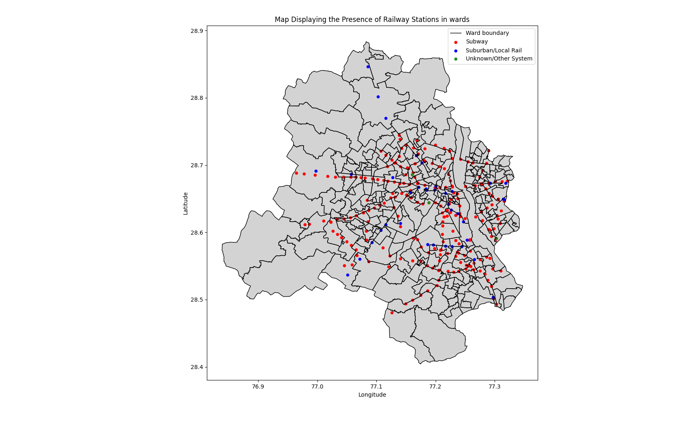
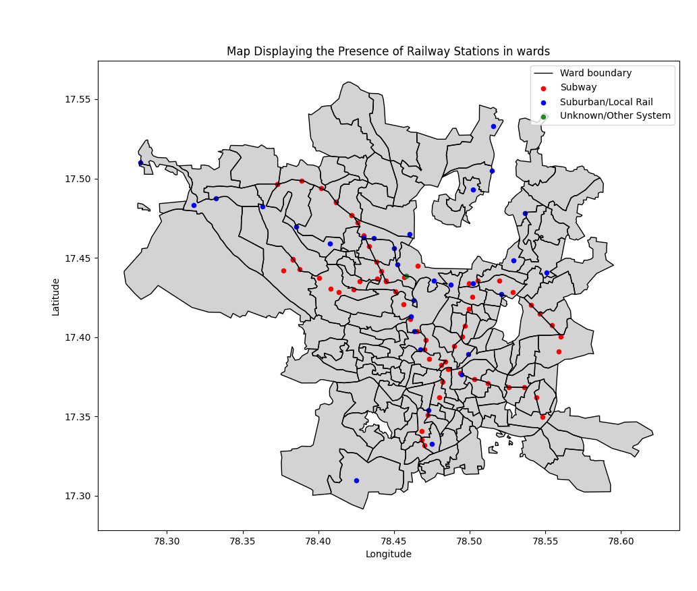
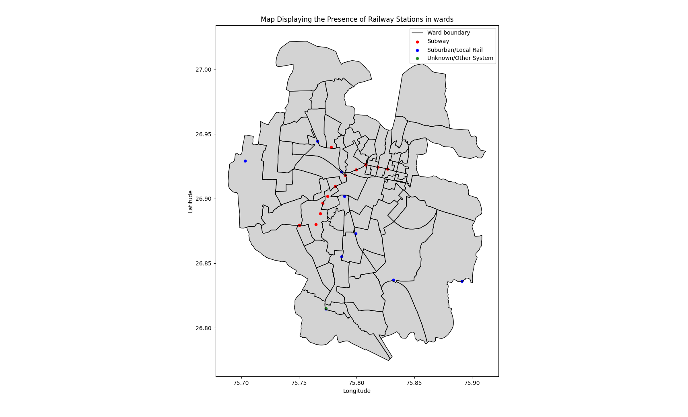
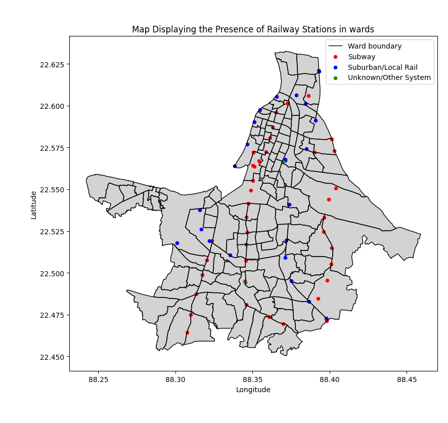
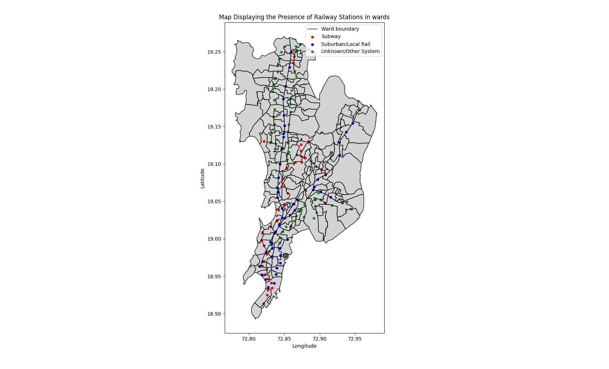

<div align="center">

# 🚆 Ward Railway Network

**A branch of [Urban Mobility Geographic Information Systems](https://github.com/shreyanspeaking-arch/Urban-Mobility-Geographic-Information-Systems), a collection of Python programs that map and measure the wards of Indian cities.**

  

</div>

Railway stations are the entry points to a city's rail network. Plotting them over the ward map shows which wards are served by suburban or local trains, which by the metro, and which have no station at all.

## 📂 Programs in this branch

| Program | What it does |
|---|---|
| [**Railway Station Mapping with Electoral Ward Grid**](#railway-station-mapping-with-electoral-ward-grid) | Every railway station in a city from OpenStreetMap, sorted into suburban or local rail and subway, saved to Excel and shown on the ward map |

## ⚙️ Getting started

```bash
git clone -b Ward-Railway-Network --single-branch https://github.com/shreyanspeaking-arch/Urban-Mobility-Geographic-Information-Systems.git
cd Urban-Mobility-Geographic-Information-Systems
curl -LO https://github.com/shreyanspeaking-arch/Urban-Mobility-Geographic-Information-Systems/raw/Input-gpkg-files/kolkata_wards_141.gpkg
pip install geopandas osmnx pandas numpy matplotlib openpyxl
python Railway_Station_Mapping_with_Electoral_Ward_Grid.py
```

Every program is interactive: it asks for its inputs one at a time in the terminal, then saves the results to an `.xlsx` file and shows its map. Input files for 8 cities are on the [Input gpkg files](https://github.com/shreyanspeaking-arch/Urban-Mobility-Geographic-Information-Systems/tree/Input-gpkg-files) branch. This program also needs an internet connection, because it downloads the railway stations from OpenStreetMap.

---

## Railway Station Mapping with Electoral Ward Grid

📄 **File:** [`Railway_Station_Mapping_with_Electoral_Ward_Grid.py`](./Railway_Station_Mapping_with_Electoral_Ward_Grid.py)

Finds every railway station inside a city's wards using OpenStreetMap data, lets the user sort the stations into suburban or local rail and subway systems by their operator, plots them over the ward map, and saves the list of stations to Excel.

**How it works**

1. The user enters the name of a ward-boundary file, such as a `.gpkg` file from the [Input gpkg files](https://github.com/shreyanspeaking-arch/Urban-Mobility-Geographic-Information-Systems/tree/Input-gpkg-files) branch. The program lists the file's columns and asks which one holds the ward name or number. If the file has no `geometry` column, it also asks which column holds the ward shapes.
2. All railway stations inside the wards (`railway=station`) are downloaded from OpenStreetMap with `osmnx`, and each station is reduced to a single point that is guaranteed to lie inside its shape.
3. The stations are grouped by their operator, and the program prints the list of operators. For each operator, the user enters whether it runs a suburban or local rail system or a subway system, and every station of that operator is labelled accordingly.
4. Stations with no operator recorded in OpenStreetMap are counted. The user can either label each of them one by one as suburban or local rail, subway, or unknown, or leave them all as an unknown or other system.
5. The user enters a name for the output file (without `.xlsx`), and the program saves every station, with its OpenStreetMap details and a `Kind of Railway` column, to that Excel file.
6. The program then draws the wards in grey with their boundaries outlined, and marks the stations in three colours: red for subway, blue for suburban or local rail, and green for unknown or other systems. A group with no stations, such as a city without a metro, is left out of the map and its legend.

**🧪 Sample input and output**

| Input | Output |
|---|---|
| [`ahmedabad_wards.gpkg`](https://github.com/shreyanspeaking-arch/Urban-Mobility-Geographic-Information-Systems/blob/Input-gpkg-files/ahmedabad_wards.gpkg) | [`Railway_Stations_in_Ahmedabad.xlsx`](./Railway_Stations_in_Ahmedabad.xlsx)<br>[`Railway_Stations_in_Ahmedabad.png`](./Railway_Stations_in_Ahmedabad.png) |
| [`bengaluru_wards_2022.gpkg`](https://github.com/shreyanspeaking-arch/Urban-Mobility-Geographic-Information-Systems/blob/Input-gpkg-files/bengaluru_wards_2022.gpkg) | [`Railway_Stations_in_Bengaluru.xlsx`](./Railway_Stations_in_Bengaluru.xlsx)<br>[`Railway_Stations_in_Bengaluru.png`](./Railway_Stations_in_Bengaluru.png) |
| [`chennai_wards.gpkg`](https://github.com/shreyanspeaking-arch/Urban-Mobility-Geographic-Information-Systems/blob/Input-gpkg-files/chennai_wards.gpkg) | [`Railway_Stations_in_Chennai.xlsx`](./Railway_Stations_in_Chennai.xlsx)<br>[`Railway_Stations_in_Chennai.png`](./Railway_Stations_in_Chennai.png) |
| [`delhi_wards.gpkg`](https://github.com/shreyanspeaking-arch/Urban-Mobility-Geographic-Information-Systems/blob/Input-gpkg-files/delhi_wards.gpkg) | [`Railway_Stations_in_Delhi.xlsx`](./Railway_Stations_in_Delhi.xlsx)<br>[`Railway_Stations_in_Delhi.png`](./Railway_Stations_in_Delhi.png) |
| [`hyderabad_wards.gpkg`](https://github.com/shreyanspeaking-arch/Urban-Mobility-Geographic-Information-Systems/blob/Input-gpkg-files/hyderabad_wards.gpkg) | [`Railway_Stations_in_Hyderabad.xlsx`](./Railway_Stations_in_Hyderabad.xlsx)<br>[`Railway_Stations_in_Hyderabad.png`](./Railway_Stations_in_Hyderabad.png) |
| [`jaipur_wards.gpkg`](https://github.com/shreyanspeaking-arch/Urban-Mobility-Geographic-Information-Systems/blob/Input-gpkg-files/jaipur_wards.gpkg) | [`Railway_Stations_in_Jaipur.xlsx`](./Railway_Stations_in_Jaipur.xlsx)<br>[`Railway_Stations_in_Jaipur.png`](./Railway_Stations_in_Jaipur.png) |
| [`kolkata_wards_141.gpkg`](https://github.com/shreyanspeaking-arch/Urban-Mobility-Geographic-Information-Systems/blob/Input-gpkg-files/kolkata_wards_141.gpkg) | [`Railway_Stations_in_Kolkata.xlsx`](./Railway_Stations_in_Kolkata.xlsx)<br>[`Railway_Stations_in_Kolkata.png`](./Railway_Stations_in_Kolkata.png) |
| [`mumbai_electoral_wards_2017.gpkg`](https://github.com/shreyanspeaking-arch/Urban-Mobility-Geographic-Information-Systems/blob/Input-gpkg-files/mumbai_electoral_wards_2017.gpkg) | [`Railway_Stations_in_Mumbai.xlsx`](./Railway_Stations_in_Mumbai.xlsx)<br>[`Railway_Stations_in_Mumbai.png`](./Railway_Stations_in_Mumbai.png) |

<!-- preview:start -->
**📋 First five rows**

<details>
<summary><code>Railway_Stations_in_Ahmedabad.xlsx</code></summary>

| name | operator | network | railway | Kind of Railway |
|---|---|---|---|---|
| Naroda | WR | IR | station | Suburban/Local Rail |
| Vastrapur | WR | IR | station | Suburban/Local Rail |
| Maninagar | WR | IR | station | Suburban/Local Rail |
| Sabarmati | WR | IR | station | Suburban/Local Rail |
| Asarva | WR | IR | station | Suburban/Local Rail |

<sub>48 rows in total; the `geometry` column (station locations) is left out; showing 5 of its 32 columns.</sub>

</details>

<details>
<summary><code>Railway_Stations_in_Bengaluru.xlsx</code></summary>

| name | operator | network | railway | Kind of Railway |
|---|---|---|---|---|
| Bangalore Cantonment | SWR | IR | station | Suburban/Local Rail |
| Bengaluru East | SWR | IR | station | Suburban/Local Rail |
| Kengeri | SWR | IR | station | Suburban/Local Rail |
| Nayandahalli | SWR | IR | station | Suburban/Local Rail |
| Chikka Banavara | SWR | IR | station | Suburban/Local Rail |

<sub>94 rows in total; the `geometry` column (station locations) is left out; showing 5 of its 46 columns.</sub>

</details>

<details>
<summary><code>Railway_Stations_in_Chennai.xlsx</code></summary>

| name | operator | network | railway | Kind of Railway |
|---|---|---|---|---|
| Chennai Chetpet | Southern Railway | IR | station | Suburban/Local Rail |
| Pattaravakkam | SR | IR | station | Suburban/Local Rail |
| Anna Nagar West | SR | IR | station | Suburban/Local Rail |
| Chennai Park Town | SR | IR | station | Suburban/Local Rail |
| Chennai Park | SR | IR | station | Suburban/Local Rail |

<sub>131 rows in total; the `geometry` column (station locations) is left out; showing 5 of its 44 columns.</sub>

</details>

<details>
<summary><code>Railway_Stations_in_Delhi.xlsx</code></summary>

| name | operator | network | railway | Kind of Railway |
|---|---|---|---|---|
| Ramesh Nagar | Delhi Metro Rail Corporation Limited | Delhi Metro | station | Subway |
| Anand Vihar | Northern Railway | Indian Railways | station | Suburban/Local Rail |
| Patel Nagar | Delhi Metro Rail Corporation Limited | Delhi Metro | station | Subway |
| Rithala | Delhi Metro Rail Corporation Limited | Delhi Metro | station | Subway |
| Pratap Nagar | Delhi Metro Rail Corporation Limited | Delhi Metro | station | Subway |

<sub>267 rows in total; the `geometry` column (station locations) is left out; showing 5 of its 91 columns.</sub>

</details>

<details>
<summary><code>Railway_Stations_in_Hyderabad.xlsx</code></summary>

| name | operator | network | railway | Kind of Railway |
|---|---|---|---|---|
| Khairatabad | SCR | IR | station | Suburban/Local Rail |
| Necklace Road | SCR | IR | station | Suburban/Local Rail |
| Hyderabad Deccan Nampally | SCR | IR | station | Suburban/Local Rail |
| Malakpet | SCR | IR | station | Suburban/Local Rail |
| Kacheguda | SCR | IR | station | Suburban/Local Rail |

<sub>97 rows in total; the `geometry` column (station locations) is left out; showing 5 of its 50 columns.</sub>

</details>

<details>
<summary><code>Railway_Stations_in_Jaipur.xlsx</code></summary>

| name | operator | network | railway | Kind of Railway |
|---|---|---|---|---|
| Getor Jagatpura | NWR | IR | station | Suburban/Local Rail |
| Dahar-Ka-Balaji | NWR | IR | station | Suburban/Local Rail |
| Ambabadi Metro (u/c) | Jaipur Metro Rail Corporation Limited | Jaipur Metro | station | Subway |
| Gandhi Nagar Jaipur | North Western Railway | Indian Railways | station | Suburban/Local Rail |
| Bais Godam | NWR | IR | station | Suburban/Local Rail |

<sub>24 rows in total; the `geometry` column (station locations) is left out; showing 5 of its 36 columns.</sub>

</details>

<details>
<summary><code>Railway_Stations_in_Kolkata.xlsx</code></summary>

| name | operator | network | railway | Kind of Railway |
|---|---|---|---|---|
| Sealdah | ER | IR | station | Suburban/Local Rail |
| Baghajatin | ER | IR | station | Suburban/Local Rail |
| Ballygunge Junction | ER | IR | station | Suburban/Local Rail |
| Sovabazar Ahiritola | ER | IR | station | Suburban/Local Rail |
| Eden Gardens | ER | IR | station | Suburban/Local Rail |

<sub>68 rows in total; the `geometry` column (station locations) is left out; showing 5 of its 48 columns.</sub>

</details>

<details>
<summary><code>Railway_Stations_in_Mumbai.xlsx</code></summary>

| name | operator | network | railway | Kind of Railway |
|---|---|---|---|---|
| Dahisar | WR | Mumbai Suburban Railway | station | Suburban/Local Rail |
| Santa Cruz | WR | Mumbai Suburban Railway | station | Suburban/Local Rail |
| Khar Road | WR | Mumbai Suburban Railway | station | Suburban/Local Rail |
| Kanjur Marg | CR | IR | station | Suburban/Local Rail |
| Vidyavihar | CR | IR | station | Suburban/Local Rail |

<sub>158 rows in total; the `geometry` column (station locations) is left out; showing 5 of its 79 columns.</sub>

</details>
<!-- preview:end -->

**🗺️ Sample maps**

| | |
|:-:|:-:|
| **Ahmedabad**<br><br><sub><b>Figure 1.</b> Railway stations in Ahmedabad on the ward map<br><a href="./Railway_Stations_in_Ahmedabad.png">Railway_Stations_in_Ahmedabad.png</a> · from <a href="https://github.com/shreyanspeaking-arch/Urban-Mobility-Geographic-Information-Systems/blob/Input-gpkg-files/ahmedabad_wards.gpkg">ahmedabad_wards.gpkg</a></sub> | **Bengaluru**<br><br><sub><b>Figure 2.</b> Railway stations in Bengaluru on the ward map<br><a href="./Railway_Stations_in_Bengaluru.png">Railway_Stations_in_Bengaluru.png</a> · from <a href="https://github.com/shreyanspeaking-arch/Urban-Mobility-Geographic-Information-Systems/blob/Input-gpkg-files/bengaluru_wards_2022.gpkg">bengaluru_wards_2022.gpkg</a></sub> |
| **Chennai**<br><br><sub><b>Figure 3.</b> Railway stations in Chennai on the ward map<br><a href="./Railway_Stations_in_Chennai.png">Railway_Stations_in_Chennai.png</a> · from <a href="https://github.com/shreyanspeaking-arch/Urban-Mobility-Geographic-Information-Systems/blob/Input-gpkg-files/chennai_wards.gpkg">chennai_wards.gpkg</a></sub> | **Delhi**<br><br><sub><b>Figure 4.</b> Railway stations in Delhi on the ward map<br><a href="./Railway_Stations_in_Delhi.png">Railway_Stations_in_Delhi.png</a> · from <a href="https://github.com/shreyanspeaking-arch/Urban-Mobility-Geographic-Information-Systems/blob/Input-gpkg-files/delhi_wards.gpkg">delhi_wards.gpkg</a></sub> |
| **Hyderabad**<br><br><sub><b>Figure 5.</b> Railway stations in Hyderabad on the ward map<br><a href="./Railway_Stations_in_Hyderabad.png">Railway_Stations_in_Hyderabad.png</a> · from <a href="https://github.com/shreyanspeaking-arch/Urban-Mobility-Geographic-Information-Systems/blob/Input-gpkg-files/hyderabad_wards.gpkg">hyderabad_wards.gpkg</a></sub> | **Jaipur**<br><br><sub><b>Figure 6.</b> Railway stations in Jaipur on the ward map<br><a href="./Railway_Stations_in_Jaipur.png">Railway_Stations_in_Jaipur.png</a> · from <a href="https://github.com/shreyanspeaking-arch/Urban-Mobility-Geographic-Information-Systems/blob/Input-gpkg-files/jaipur_wards.gpkg">jaipur_wards.gpkg</a></sub> |
| **Kolkata**<br><br><sub><b>Figure 7.</b> Railway stations in Kolkata on the ward map<br><a href="./Railway_Stations_in_Kolkata.png">Railway_Stations_in_Kolkata.png</a> · from <a href="https://github.com/shreyanspeaking-arch/Urban-Mobility-Geographic-Information-Systems/blob/Input-gpkg-files/kolkata_wards_141.gpkg">kolkata_wards_141.gpkg</a></sub> | **Mumbai**<br><br><sub><b>Figure 8.</b> Railway stations in Mumbai on the ward map<br><a href="./Railway_Stations_in_Mumbai.png">Railway_Stations_in_Mumbai.png</a> · from <a href="https://github.com/shreyanspeaking-arch/Urban-Mobility-Geographic-Information-Systems/blob/Input-gpkg-files/mumbai_electoral_wards_2017.gpkg">mumbai_electoral_wards_2017.gpkg</a></sub> |

---

<div align="center"><sub>📚 <a href="https://github.com/shreyanspeaking-arch/Urban-Mobility-Geographic-Information-Systems">Back to all topics</a></sub></div>
